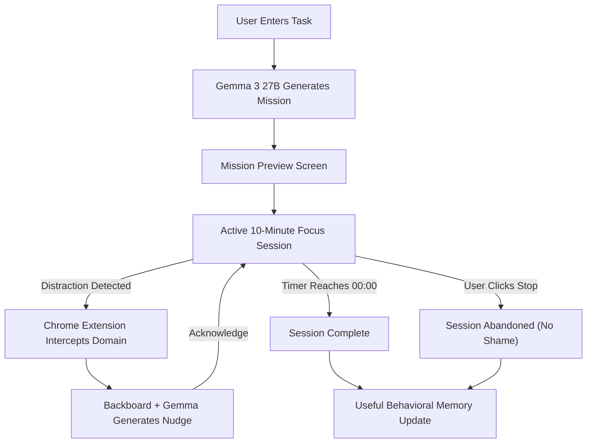
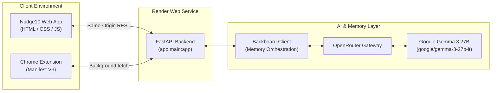

# Nudge10

> An AI-powered anti-doomscrolling focus companion built for a friend who struggles to stay productive for even 10 minutes.

Nudge10 turns large, vague tasks into tiny 10-minute focus missions, protects active focus sessions from selected distraction sites, and delivers personalized AI interventions backed by durable persistent memory.

---

## Demo

- **Live Web Application:** [https://nudge10-9tli.onrender.com](https://nudge10-9tli.onrender.com)
- **GitHub Repository:** [https://github.com/Golixco/nudge10](https://github.com/Golixco/nudge10)

The live production application runs on Render, serving both the FastAPI REST API and the static web client.

> **Note on Chrome Extension:** The Nudge10 browser companion is currently distributed as an unpacked Manifest V3 extension for personal and development use; it is not published on the Chrome Web Store.

---

## What Nudge10 Does

1. **Task Input:** The user enters a task they are avoiding or overwhelmed by.
2. **Mission Generation:** Google Gemma 3 27B breaks the task down into one concrete, low-friction starting action scoped to a 10-minute sprint.
3. **Session Launch:** The user starts the 10-minute focus session from the mission preview screen.
4. **Resilient Timing:** The countdown timer relies on real timestamps (`Date.now()`) rather than simple interval ticks, maintaining accuracy across backgrounded tabs, minimized windows, and browser refreshes.
5. **Distraction Detection:** During an active session, the companion Chrome extension monitors tab navigations to selected distraction domains.
6. **Scoped Intervention Request:** When a distraction occurs, the extension sends only normalized domain information and elapsed session timing to the backend API.
7. **Personalized AI Intervention:** Backboard and Gemma generate a concise, supportive nudge to redirect the user without shame or guilt.
8. **Return to Work:** The user can acknowledge the nudge and return directly to their active focus mission.
9. **Durable Memory Updates:** When appropriate, session completion or abandonment patterns contribute useful behavioral context to persistent assistant memory for future sessions.

---

## Why I Built It

I built Nudge10 for a close friend who repeatedly procrastinates, falls into doomscrolling loops, and struggles to sustain productive focus for even around ten minutes.

Traditional productivity tools often fail because they require extensive planning, rigid discipline, and long uninterrupted work blocks. When focus slips, these tools often provoke guilt, making it harder to restart.

Nudge10 takes the opposite approach: it intentionally avoids asking the user to become highly disciplined immediately. Instead, it lowers the psychological friction to begin by identifying exactly one concrete action that can be attempted for ten minutes. If a distraction happens, Nudge10 offers a calm, non-judgmental nudge back to the task.

---

## How a Nudge10 Session Works



### Core API Endpoints

- `POST /api/session/start` — Initializes a focus session, generates the AI mission, and assigns a unique session ID.
- `POST /api/session/distraction` — Receives a normalized distraction domain event and returns a personalized AI nudge.
- `POST /api/session/complete` — Records session completion and conditionally persists useful behavioral context.
- `POST /api/session/abandon` — Gracefully exits an active session with supportive messaging and suggests a smaller starting step.

---

## Architecture



### Frontend
A lightweight, zero-build single-page application built with vanilla HTML, CSS, and modern JavaScript. It is served directly by the FastAPI web service, removing the need for bundlers, node modules, or separate client hosting.

### Backend
A FastAPI application handling session lifecycle management, request validation, static file delivery, and AI orchestration.

### AI
Google Gemma 3 27B (`google/gemma-3-27b-it`), an open-weight model accessed through OpenRouter and orchestrated via the Backboard SDK.

### Memory
Persistent assistant-level memory managed by Backboard. Nudge10 utilizes:
- **Explicit user preferences:** Durable preferences stored directly in assistant memory.
- **Learned behavioral patterns:** Meaningful habits recorded only when validated and sufficiently durable.
- **Cross-session context:** Memory retrieval that informs mission and nudge generation across separate sessions.

### Browser Protection
A Chrome Manifest V3 extension utilizing a service worker, content scripts, and `chrome.storage.local`. It listens strictly for navigation events to configured distraction domains while a Nudge10 session is active.

### Deployment
A single web service running on Render. FastAPI serves both the REST endpoints and the client interface under one unified origin.

---

## Privacy

Nudge10 is designed with strict data minimization principles. It intentionally does **not** monitor or collect raw browsing history.

When a distraction event occurs during an active focus session, the extension communicates strictly:
- The normalized domain category (e.g. `youtube.com`, `instagram.com`, `reddit.com`, `x.com`, `twitter.com`)
- The active `session_id` and computed elapsed seconds

The extension **never** reads, inspects, or transmits:
- Full page URLs or pathnames
- Query parameters or search terms
- Video IDs or channel names
- Page content, text, or DOM nodes
- Page titles or metadata
- Cookies, local storage, or session tokens
- Passwords or form inputs

All Backboard API credentials and assistant configuration remain securely on the server and are never exposed to the frontend or browser extension.

---

## Tech Stack

| Layer | Technology |
| --- | --- |
| Frontend | HTML, CSS, JavaScript |
| Backend | FastAPI |
| AI Model | Google Gemma 3 27B (`google/gemma-3-27b-it`) |
| AI Orchestration | Backboard |
| Model Routing | OpenRouter |
| Browser Integration | Chrome Extension (Manifest V3) |
| Deployment | Render |
| Client Persistence | `localStorage` |
| Extension Persistence | `chrome.storage.local` |

---

## Local Development

### 1. Clone Repository

```bash
git clone https://github.com/Golixco/nudge10.git
cd nudge10
```

### 2. Create Virtual Environment

```bash
python3 -m venv .venv
source .venv/bin/activate
```

### 3. Install Dependencies

```bash
pip install -r requirements.txt
```

### 4. Configure Environment

```bash
cp .env.example .env
```

Edit `.env` to configure your Backboard credentials. These values must remain private and should **never** be committed to version control:

```ini
BACKBOARD_API_KEY=<your-backboard-api-key>
BACKBOARD_ASSISTANT_ID=<your-nudge10-assistant-id>
BACKBOARD_MODEL_PROVIDER=openrouter
BACKBOARD_MODEL_NAME=google/gemma-3-27b-it
APP_ENV=development
```

### 5. Run Application

```bash
uvicorn app.main:app --reload --port 8000
```

Open your browser to:
- **Web Application:** [http://localhost:8000](http://localhost:8000)
- **Interactive API Documentation:** [http://localhost:8000/docs](http://localhost:8000/docs)

---

## Chrome Extension

The Nudge10 companion extension is loaded locally as an unpacked Manifest V3 extension.

### Installation Steps

1. Open Google Chrome and navigate to `chrome://extensions`.
2. Enable **Developer mode** using the toggle in the upper-right corner.
3. Click **Load unpacked** in the upper-left toolbar.
4. Select the `extension/` directory from this repository.
5. Open the Nudge10 web app. The diagnostics panel will confirm connection with `Browser protection: ON`.

By default, `extension/config.js` is configured to target the production deployment (`https://nudge10-9tli.onrender.com`), while retaining commented settings for `http://localhost:8000` testing.

---

## Render Deployment

Nudge10 is deployed on Render as a unified Python Web Service.

- **Repository:** [https://github.com/Golixco/nudge10](https://github.com/Golixco/nudge10)
- **Live URL:** [https://nudge10-9tli.onrender.com](https://nudge10-9tli.onrender.com)
- **Runtime:** `Python`
- **Build Command:** `pip install -r requirements.txt`
- **Start Command:** `uvicorn app.main:app --host 0.0.0.0 --port $PORT`
- **Health Check Path:** `/api/health`

### Required Environment Variables in Render Dashboard:

Configure the following variables in the Render dashboard:
- `BACKBOARD_API_KEY`: Your Backboard API secret key
- `BACKBOARD_ASSISTANT_ID`: The UUID of your provisioned Nudge10 assistant
- `BACKBOARD_MODEL_PROVIDER`: `openrouter`
- `BACKBOARD_MODEL_NAME`: `google/gemma-3-27b-it`
- `APP_ENV`: `production`

---

## Project Structure

```text
nudge10/
├── app/                       # FastAPI backend application
│   ├── __init__.py
│   ├── backboard_service.py   # Backboard API client & Gemma integration
│   ├── config.py              # Environment settings & production toggles
│   ├── main.py                # API routes, CORS & static frontend serving
│   ├── schemas.py             # Pydantic request & response models
│   └── session_service.py     # In-memory session tracking & memory gating
├── frontend/                  # Zero-build static frontend
│   ├── index.html             # Single-page application markup & logic
│   └── styles.css             # Minimalist dark-mode styling
├── extension/                 # Chrome Manifest V3 companion extension
│   ├── background.js          # Service worker tab listener & session store
│   ├── config.js              # API and web app endpoint configuration
│   ├── content.js             # Window messaging bridge & intervention overlay
│   ├── manifest.json          # MV3 permissions and content script matches
│   └── overlay.css            # Non-judgmental distraction intervention UI
├── scripts/                   # Setup, verification & development utilities
│   ├── setup_backboard.py     # Idempotent assistant provisioning
│   ├── verify_backboard.py    # Assistant metadata verification
│   ├── test_memory.py         # Multi-thread memory verification
│   ├── test_preference_memory.py # Preference storage testing
│   ├── smoke_test_mission.py  # Direct mission generation check
│   └── smoke_test_session_api.py # End-to-end API lifecycle smoke test
├── tests/                     # Automated test suite
│   ├── __init__.py
│   ├── test_backboard.py       # AI service & prompt formatting tests
│   ├── test_extension.py       # MV3 permissions & lifecycle tests
│   ├── test_memory.py          # Memory extraction tests
│   ├── test_preference_memory.py # User preference tests
│   └── test_session.py         # Session lifecycle & API route tests
├── docs/                      # Project documentation & logs
│   ├── BACKBOARD_SETUP.md     # Assistant provisioning guide
│   └── BUILD_LOG.md           # Incremental architectural build log
├── .env.example               # Environment variable template
├── render.yaml                # Render Infrastructure Blueprint
├── requirements.txt           # Pinned Python dependencies
└── README.md                  # Project documentation
```

### Directory Roles

- **`app/`**: Contains core application services, endpoints, data validation schemas, and Backboard integration logic.
- **`frontend/`**: Contains the zero-build single-page user interface served directly by FastAPI.
- **`extension/`**: Contains the Manifest V3 browser companion for active distraction detection and intervention.
- **`scripts/`**: Contains administrative and development utilities for assistant provisioning and end-to-end verification.
- **`tests/`**: Contains unit and integration test suites executed with `pytest`.
- **`docs/`**: Contains supplemental technical documentation, setup guides, and project build history.

---

## Testing

The repository includes comprehensive automated tests covering backend routes, Backboard prompt generation, persistent memory behavior, focus session lifecycles, and extension Manifest V3 permissions.

To execute the test suite:

```bash
pytest
```

Current test status: **85 tests passing**.

---

## Hacktoberfest 2026

- **Challenge:** [Hacktoberfest Weekend Challenge — Build for a Friend](https://dev.to/challenges/hacktoberfest-weekend-2026-10-01)
- **Theme:** Build for a Friend
- **Context:** Built specifically as a new project for the challenge to help a friend overcome procrastination, attention drift, and doomscrolling cycles.
- **Open-Source AI at the Core:** Uses Google's open-weight Gemma model (`google/gemma-3-27b-it`) via OpenRouter to power all mission generation and intervention nudges.
- **AI Orchestration & Memory:** Backboard manages assistant conversations and durable persistent memory across separate focus sessions.
- **Production Infrastructure:** Deployed as a unified Python web service on Render.

---

## Open Innovation

Nudge10 uses an open-weight Gemma model instead of relying exclusively on closed proprietary model APIs. This approach provides greater flexibility in model evaluation, prompt tuning, and architectural choices, while creating a foundation for future experiments with local or privacy-preserving inference.

Backboard complements this by providing the assistant orchestration and persistent memory layer, decoupling model execution from state and memory management.

---

## License

This repository does not currently include an open-source license.
